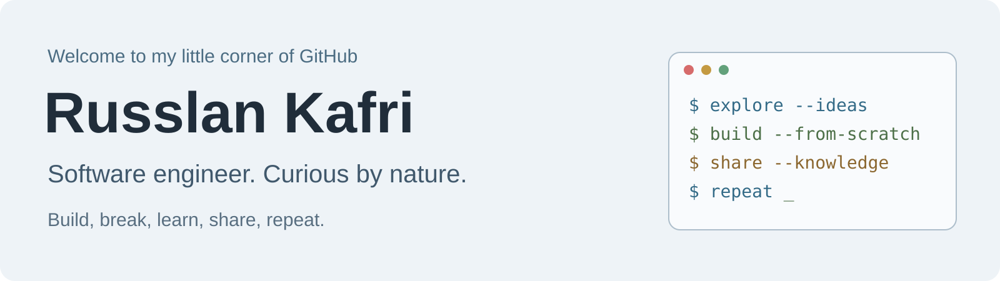

  <picture>
    <source media="(prefers-color-scheme: dark)" srcset="assets/banner-dark.svg">
    <source media="(prefers-color-scheme: light)" srcset="assets/banner-light.svg">
    
  </picture>

  
  
  

## Hey there, welcome! 👋

I'm Russlan, a software engineer, architect and open-source enthusiast based in Sweden 🇸🇪.

My journey through computing spans several generations of technology — from the days of DOS, 8-bit microcontrollers and writing software close to the hardware, to modern distributed systems and cloud-native architectures. Along the way, I've ventured into embedded systems, industrial automation, computer graphics, compiler construction, database internals, networking, infrastructure and application development.

I've always enjoyed building things from the ground up — from bits and bytes to distributed systems. What keeps me going is curiosity, the joy of solving interesting problems and a fascination with how things work under the hood. I value simplicity, performance, reliability and good engineering, regardless of the technology or scale.

This is my little corner of GitHub: a place where old ideas meet new ones, where experiments turn into useful tools, and where I share some of the things I've built and learned along the way.

Feel free to look around, experiment, contribute or simply say hello!

## 🛠️ Things I like to build

- **Libraries and developer tools** that make everyday engineering a little easier.
- **Distributed systems** that behave predictably even when things go wrong.
- **Languages, parsers and code generators** that turn ideas into useful abstractions.
- **Cloud and infrastructure tooling** that makes complex environments easier to understand and operate.
- **Experiments and proofs of concept** that turn architectural questions into something we can actually run, break and learn from.
- **Systems and storage engines** — exploring data structures, indexing algorithms, storage internals and low-level programming.
- **AI-assisted engineering and governance tooling** that helps make AI-driven software development more reliable, verifiable and accountable.

## 📦 Open-source projects

Here are a few projects you might find interesting. The libraries and tools address concrete problems; the PoCs are hands-on explorations rather than production-ready applications.

### The Xpress family — reusable .NET libraries

| Project | What it's for | NuGet |
| :--- | :--- | :--- |
| [**XpressData**](https://github.com/russlank/XpressData) | A lightweight SQL Server micro-ORM with strongly typed queries and flexible entity mapping. |  |
| [**XpressWork**](https://github.com/russlank/XpressWork) | In-memory background work with safe DI scopes, context propagation, debounce and throttle scheduling. |  |
| [**XpressCache**](https://github.com/russlank/XpressCache) | Concurrent in-memory caching with single-flight loading to prevent cache stampedes. |  |

### Systems, languages & developer tools

| Project | What it's about |
| :--- | :--- |
| [**LangForge**](https://github.com/russlank/lang-forge) | Generate scanners and parsers for DSLs, compilers and language tooling from a grammar, targeting Go, C#, C and C++. |
| [**XpressFormula**](https://github.com/russlank/XpressFormula) | A native C++ desktop experiment for visualizing mathematical expressions, 2D curves, 3D surfaces and implicit equations. |
| [**Bin X-ray**](https://github.com/russlank/BinXray) | A native C++ tool for interactive binary analysis, revealing hidden structures and patterns through 2D byte-pair and 3D byte-trigram visualization, integrated hex inspection and bitmap navigation. |
| [**Backup Cleanup**](https://github.com/russlank/backup-cleanup) | A cross-platform Go utility for automated SQL Server backup retention using configurable Grandfather-Father-Son (GFS) policies, with dry-run support and compatibility with [Ola Hallengren's maintenance solution](https://github.com/olahallengren/sql-server-maintenance-solution). |
| [**Azure Survey**](https://github.com/russlank/azure-survey) | A Go-based utility for exploring Azure subscription inventories, networking, resource exposure and governance signals. |

### 🔬 Distributed systems playground

I like exploring the less obvious side of distributed systems: what happens when messages arrive twice, a service crashes mid-operation, a workflow outlives its worker, or a database becomes temporarily unavailable?

| Project | What you can explore |
| :--- | :--- |
| [**Dapr Distributed Fulfillment**](https://github.com/russlank/dapr-distributed-fulfillment-poc) | Durable workflows with Dapr and .NET, SQL-owned business invariants, idempotency, compensation, reconciliation and scripted failure drills. |
| [**CDC Event Pipeline**](https://github.com/russlank/cdc-event-pipeline-poc) | SQL Server CDC, Debezium and Kafka, versioned business events, Avro contracts, bitemporal PostgreSQL projections, replay and monitoring. |

Both projects use synthetic data and provide reproducible scenarios for exploring architectural trade-offs and failure recovery.

### 🤖 AI-assisted engineering & governance

I'm interested in exploring how AI can complement established software
engineering practices — not just by generating code, but also by independently
evaluating its quality, correctness and compliance with engineering principles.

| Project | What you can explore |
| :--- | :--- |
| [**LLM CI Gate Demo**](https://github.com/russlank/llm-ci-gate-demo) | A hands-on exploration of semantic CI quality gates, combining natural-language engineering policies, multi-provider AI code reviews and deterministic merge enforcement using PR-Agent, GitHub Actions and Woodpecker CI. Explore the **[example pull requests](https://github.com/russlank/llm-ci-gate-demo/pulls)** to see how the reviews and quality checks respond to different code changes. |

The idea is to move beyond builds and tests, exploring how engineering policies
can become independently evaluated and enforceable parts of the software
delivery process.

## 🌐 Live projects & experiments

Not everything I build ends up in a public source code repository.
Some projects become publicly accessible applications — built to solve
everyday problems, explore ideas or simply for the fun of creating
something useful.

| Project | What it's about |
| :--- | :--- |
| [**Electricity Price Clock**](https://utils.digixoil.se/clock) | An interactive visualization of electricity prices across Sweden's four pricing zones (SE1–SE4), making it easier to identify the most economical hours of the day. |
| [**DigixAssistant**](https://assistant.digixoil.se/) | A privacy-first collection of browser-based developer and everyday utilities, including code formatting, file comparison, encoding, JWT inspection, hashing, regular expressions, cron expressions, image conversion and more. |
| [**Gap Challenge**](https://gap-challenge.digixoil.se/) | An interactive browser-based game exploring logical reasoning and problem-solving. |

## 🕰️ From the archives — earlier projects

A little trip down memory lane! Over the years, I've enjoyed exploring 
different areas of computing, from low-level programming and database 
internals to compiler construction, computer graphics and industrial 
automation.

Here are some of my earlier projects. Some have recently been revisited 
and modernized, while others are preserved in their original form for 
historical and educational purposes.

| Project | What it's about |
| :--- | :--- |
| [**UDB**](https://github.com/russlank/UDB) | A classic database indexing and storage library originally developed for DOS/Windows, recently modernized to C++20 as an educational project exploring B-Trees, heap storage, file-based persistence and database internals. |
| [**BACKEND**](https://github.com/russlank/BACKEND) | A retargetable compiler backend developed in 1997, featuring a dynamically constructed LR-style shift-reduce parser derived from declarative, target-specific code-generation macros. Performs pattern-based instruction selection in a single pass over the intermediate code, prioritizing larger matching operation sequences to generate optimized assembly code without hard-coding the target architecture into the translation engine. |
| [**ZigZag**](https://github.com/russlank/ZigZag) | A specialized CAD/CAM system for industrial embroidery, combining a Windows-based vector graphics editor with a DOS-based machine controller. Integrates Bézier curve modeling, computational geometry, parametric stitch generation and machine instruction optimization with needle-synchronized XY motion control, direct hardware interfacing and operational error recovery. |
| [**UDraw**](https://github.com/russlank/UDraw) | A DOS-based graphical design and robotic control system featuring a custom object-oriented touch-screen HMI for industrial computers. Integrates interactive drawing preparation, constrained trajectory optimization, coordinate transformation and motion discretization to convert two-dimensional designs into machine instructions synchronized with the continuous advancement of a textile surface, compensating for material movement while respecting the mechanical constraints of the drawing robot. |
| [**UCDT**](https://github.com/russlank/UCDT) | Universal Compiler Development Tool — a Pascal-based scanner and parser generation tool, similar in spirit to Lex and Yacc, and one of the inspirations behind my more recent [LangForge](https://github.com/russlank/lang-forge) project. |

  
🔌 Early embedded systems & microcontroller projects

Long before my explorations of modern distributed systems and cloud
infrastructure, I enjoyed working much closer to the hardware — designing
embedded systems, reverse-engineering existing equipment and developing
microcontroller-based solutions to practical problems.

Here are a few projects from those days, preserved for historical and
educational purposes.

| Project | What it's about |
| :--- | :--- |
| [**Alarm Clock**](https://github.com/russlank/Alarm-Clock-MCS-51) | A digital alarm clock based on the MCS-51 (8051) microcontroller family. |
| [**AC Controller**](https://github.com/russlank/AC-Controller-MCS-51) | An MCS-51-based retrofit controller developed in 2000 to modernize older air conditioning units with infrared remote control, automatic temperature regulation and fan speed management. Designed to minimize hardware complexity and component costs through software-based solutions, including a timer-based analog-to-digital conversion technique using capacitor charging time, voltage comparison, numerical scaling and repeated sampling instead of a dedicated ADC. |
| [**Islamic Prayer Times Clock**](https://github.com/russlank/Islamic-Prayer-Times-Clock-MCS-51) | An MCS-51-based clock that dynamically calculates Islamic prayer times from geographical coordinates and calendar dates, using a hybrid numerical approach combining quantized astronomical data, delta-encoded lookup tables and runtime trigonometric calculations, optimized for the limited memory and computational resources of an 8-bit microcontroller. |
| [**Cable TV Tuner**](https://github.com/russlank/Cable-TV-Tuner-MCS-51) | A reverse-engineering and embedded systems project from 1996, transforming commercially available TV tuners into centrally managed subscriber devices by replacing their original microcontrollers with custom MCS-51-based controllers. Features a custom pulse-width-encoded communication protocol, adaptive signal decoding, individually addressed configuration updates, compact channel-access bitmaps and persistent EEPROM storage. |
| [**Electronic Thermometer**](https://github.com/russlank/eThermometer-using-DS18B20-MCS-51) | Digital temperature measurement using an MCS-51 microcontroller and a DS18B20 temperature sensor. |
| [**FreeRTOS Template for ATmega328P**](https://github.com/russlank/FreeRTOS710-template-for-ATmega328P) | A resource-conscious embedded development template integrating FreeRTOS 7.1.0 with the ATmega328P, providing a foundation for real-time application development, preemptive multitasking, priority-based scheduling and inter-task synchronization on an 8-bit microcontroller with just 2 KB of SRAM. |

Some ideas never really get old — they just find new ways to evolve. 
Revisiting these projects is both a nostalgic experience and a reminder 
of how much we can learn from the foundations of computing.

  <a href="https://github.com/russlank?tab=repositories&type=source"><b>Explore all my repositories →</b></a>

## 💻 My toolbox

My toolbox has evolved over the years, from low-level programming, networking and traditional IT infrastructure to modern application development, distributed systems and cloud-native technologies.

While .NET and C# are at the heart of much of my work, I enjoy exploring different languages, platforms and tools. Some are part of my everyday work, others reflect earlier projects or ongoing experiments. There's always something new to learn!

  <picture>
    <source media="(prefers-color-scheme: light)"
      srcset="https://skillicons.dev/icons?i=cs,dotnet,c,cpp,java,go,php,dart,js,ts,py,nodejs,angular,nextjs,react,redux,jquery,linux,windows,azure,docker,kubernetes,nginx,kafka,rabbitmq,redis,mongodb,postgres,mysql,sqlite,grafana,prometheus,git,gitlab,github,githubactions,ansible,terraform,powershell,bash&amp;perline=10&amp;theme=light">
    
  </picture>

  
A closer look at my toolbox

| Area | Technologies & interests |
| :--- | :--- |
| **Languages & runtimes** | C#, .NET, C, C++, Go, Java, JavaScript, TypeScript, PHP, Python, Dart, Pascal, Node.js |
| **Application development** | ASP.NET Core, Blazor, Angular, React, Next.js, Redux, jQuery, desktop applications, REST APIs |
| **Distributed systems** | Microsoft Orleans, Dapr (PoCs), MassTransit, RabbitMQ, Kafka, event-driven architecture, durable workflows |
| **Data & persistence** | SQL Server, EF Core, PostgreSQL, MySQL, SQLite, MongoDB, Redis, transactions and concurrency |
| **Systems & language tooling** | Compiler construction, DSLs, parsers, code generation, storage engines, binary analysis |
| **Cloud & infrastructure** | Azure, Docker, Kubernetes, Linux, Windows Server, virtualization |
| **Web & networking** | NGINX, Apache, Traefik, IIS, routing, QoS, traffic engineering |
| **Monitoring & observability** | OpenTelemetry, Prometheus, Grafana, Jaeger, Nagios, Cacti, NetFlow |
| **DevOps & automation** | Git, GitHub, GitLab, Gitea, GitHub Actions, Woodpecker, Drone, Ansible, Terraform, PowerShell, Bash, CI/CD |
| **Quality & reliability** | Automated testing, security, resilience, performance optimization, fault tolerance |

## 🌱 Always learning

At the moment, I'm particularly interested in reliable distributed coordination, durable workflow orchestration, event-driven architecture, cloud-native platforms and better ways to build and verify software with AI-assisted development.

I believe in keeping things understandable, questioning assumptions, documenting important trade-offs and learning from real experiments — including the ones that don't work out as expected.

## 🤝 Let's build and learn together

I enjoy sharing ideas, discussing interesting problems and learning from different perspectives.

If you find something useful or interesting here, feel free to explore, open an issue, suggest an improvement or send a pull request. Feedback, questions and new ideas are always welcome.

And if a project makes your day a little easier, a ⭐ is always appreciated!

---

  <b>Thanks for stopping by! ☕</b> 
  Happy coding, happy learning, and see you around GitHub.

  <a href="https://github.com/russlank?tab=repositories">Repositories</a> ·
  <a href="https://github.com/russlank?tab=stars">Things I find interesting</a>

